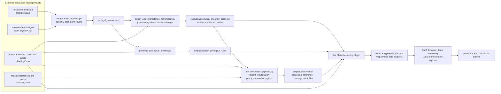

# ASTROMATCH

ASTROMATCH is an exploratory research interface for inspecting Earth's environmental diversity in the context of future lunar and Martian missions. It combines pre-existing Earth environmental data and saved cluster assignments with source-backed mission reference records. A Python data pipeline prepares transparent Earth screening summaries, and a React/Vite application presents the resulting data.

> **Interpretation:** ASTROMATCH does not validate planetary analogues, predict landing-site suitability, or calculate an Earth-to-Moon/Mars similarity score. Cluster labels are descriptive Earth context only. Missing measurements remain missing; they are not replaced with zero.

## Interview-ready project explanation

> “ASTROMATCH is a research tool that helps people explore how different environments on Earth might provide useful context for future Moon and Mars missions. I worked on an end-to-end workflow that brings environmental measurements onto a common Earth grid, reuses existing K-Means and DBSCAN cluster labels to describe Earth environments, checks data quality and missing measurements, and prepares transparent Mars screening summaries. I also worked on a React and TypeScript interface where users can explore Earth clusters, inspect strict or extended Mars screening results for Gale Crater and Utopia Planitia, and filter real Earth regions by terrain, geology, or surface features while studying lunar reference sites. The project combines spatial data processing, Python validation and summarization, frontend data visualization, and clear CSV/GeoJSON exports. An important part of the work is being honest about what the results mean: the clusters are not predictions, the Moon view filters Earth data rather than finding lunar matches, and the Mars screens are exploratory filters rather than validated rankings. That makes the results easier to inspect and helps avoid overstating scientific conclusions.”

## At a glance



The diagram describes the **rebuildable data workflow**. The repository already contains generated Earth and mission outputs, so the ordinary frontend workflow does not require rerunning the source-layer merge or retraining clustering models.

## Project architecture

| Component | Responsibility |
|---|---|
| `predictors.zarr/`, `earth_layers/` | Earth predictor grid and additional CSV layers used by the optional Earth-data rebuild. |
| `mission_data/raw/` | Source-backed lunar and Mars reference measurements and descriptions. |
| `mission_data/processed/`, `mission_data/scoring/` | Reference-site registry, feature metadata/compatibility, and the explicit screening policy. |
| `clustring/` | Existing K-Means and DBSCAN cell assignments and preprocessing metadata. The folder name is intentionally spelled `clustring` in this repository. |
| `merge_earth_features.py` | Combines the Zarr predictors and additional layers onto the reference Earth grid. Uses spherical nearest-neighbor mapping for source layers that are not already on that grid, subject to a distance limit. |
| `enrich_and_characterize_astromatch.py` | Joins the saved cluster labels to `earth_all_features.csv`, checks label/source consistency, and writes the enriched Earth data, cluster profiles, coverage summaries, and an enrichment manifest. It does not fit a model or change labels. |
| `generate_geological_profiles.py` | Produces cluster-level geological composition and geology-coverage summaries. |
| `run_astromatch_pipeline.py` | Validates the enriched Earth grid and saved labels; applies the configured Mars screening scenarios; creates connected-region summaries, mission reference details, coverage reports, audits, and a run manifest. It does not train models or calculate numeric similarity. |
| `outputs/` | Generated Earth and mission data consumed by the application, as well as audits and downstream outputs. |
| `vite.config.ts` | Vite development/preview plugin that serves a fixed allowlist of existing local files under `/data/*`; there is no separate API server or database. |
| `src/data.ts` | Fetches and parses the CSV/JSON inputs with Papa Parse and converts them into typed frontend data. |
| `src/App.tsx`, `src/Documentary.tsx` | Landing, Earth Explorer, mission screening, and project/methodology views. |
| `src/GlobeCanvas.tsx` | Canvas-rendered Earth map and markers, avoiding an individual DOM element for every grid cell. |
| `src/LunarContextExplorer.tsx`, `src/lunarContext.ts` | Browser-side Earth-only filters for lunar reference contexts, connected-cell grouping, summaries, comparisons, and CSV/GeoJSON export. |
| `src/screeningOrder.ts` | Stable, evidence-based display ordering for Mars screening results. The order is not a similarity ranking. |
| `tests/` | Python screening/pipeline tests and Node tests for frontend data loading, lunar-context filters, missing values, regions, and exports. |

### Application data flow

The frontend requests existing local files through the Vite `/data` routes. The allowlist and source-file mapping are defined in `vite.config.ts`. `src/data.ts` loads the Earth cell assignments, cluster statistics, mission sites, Mars screening regions, coverage, policy, and mission reference details.

- **Global Earth Explorer:** displays the saved K-Means assignments and precomputed cluster profiles, geological composition, and measurement coverage.
- **Mars screening:** reads generated region summaries and lets users inspect strict or extended Earth screens alongside the Gale Crater or Utopia Planitia reference profile. The two Mars reference sites have separate records but currently share the same Earth-wide screening cell set in each scenario.
- **Lunar context:** loads the enriched Earth cells and applies user-selected Earth terrain, geology, or surface filters in the browser. The output is a collection of terrestrial contexts, not a lunar candidate dataset.
- **Exports:** Mars screening and lunar-context views can export their displayed results as CSV or GeoJSON. GeoJSON locations are representative points, not region-boundary polygons.

The frontend does not use every generated pipeline file. For example, `mars_screening_candidates.csv`, `mission_matching_results.csv`, `top_analogs_per_reference.csv`, and the pre-generated `analogue_regions.geojson` remain available for audit/downstream use; the UI reads `analogue_regions.csv` and builds its own view/export data.

## End-to-end workflow

### 1. Prepare or update source inputs (optional rebuild)

The checked-in project includes Earth predictor/layer files, mission references, preprocessing metadata, saved cluster assignments, and generated outputs. When source data changes, keep the source files and their provenance under the existing `predictors.zarr/`, `earth_layers/`, and `mission_data/` layout. Review measurement definitions, coordinate systems, spatial resolution, time periods, and units before interpreting or comparing any layer.

`create_mission_registry.py` rebuilds the reference-site and Earth-feature compatibility registries from the current source records:

```powershell
python .\create_mission_registry.py
```

### 2. Build the combined Earth feature table (optional rebuild)

The merge script reads the Zarr predictor grid and the additional Earth CSV layers, normalizes coordinates and column names, and writes `earth_all_features.csv`. Values that cannot be spatially aligned within the configured maximum distance remain unavailable.

```powershell
python .\merge_earth_features.py
python .\validate_earth_features.py
```

`validate_earth_features.py` checks the combined feature coverage and spatial alignment. `audit_earth_features.py` and `inspect_enriched_dataset.py` provide additional data-quality inspection; they are analysis utilities rather than required frontend startup steps.

### 3. Reuse the saved clusters and generate Earth summaries

The project provides saved K-Means/DBSCAN cell labels and preprocessing metadata. They are inputs, not models to retrain for normal use. Join the labels to the current master data and generate Earth cluster statistics and geological summaries:

```powershell
python .\enrich_and_characterize_astromatch.py
python .\generate_geological_profiles.py
```

This step writes `outputs/astromatch_enriched_earth.csv`, cluster profile/coverage files, and geological summaries under `outputs/`. Keep label mismatches and missing feature values visible; do not silently impute them or reinterpret cluster IDs as suitability scores.

### 4. Generate mission screening and audit outputs

The mission pipeline reads the enriched Earth table, the saved K-Means/DBSCAN assignments, the mission-site and compatibility registries, and `mission_data/scoring/mission_scoring_policy.json`. It validates its inputs and writes the screening outputs under `outputs/astromatch/`.

```powershell
python .\run_astromatch_pipeline.py
```

The default policy defines:

- **Strict Mars screen:** land fraction at least `0.5`, vegetation at most `0.1`, and terrestrial aridity class Hyper-aride or Aride.
- **Extended Mars screen:** land fraction at least `0.5`, vegetation at most `0.2`, and terrestrial aridity class Hyper-aride, Aride, or Semi-aride.
- **Southern polar exception:** eligible low-vegetation land cells south of 60°S with missing aridity are identified as aridity-unknown, not described as dry.
- **No numeric similarity:** numerical Earth-to-Moon/Mars scoring is disabled unless scientifically compatible, source-verified criteria are explicitly approved.

The screening output includes cell-level candidates, connected-region summaries, coverage and filter audits, source-backed mission reference details, an extended-screen GeoJSON, and a run manifest. Gale and Utopia results are duplicated per reference for reporting; they are not site-specific Mars matches.

### 5. Run the web application

From the repository root:

```powershell
npm ci
npm run dev
```

Vite prints the local URL (normally `http://localhost:5173/`). To bind only to loopback:

```powershell
npm run dev -- --host 127.0.0.1
```

The application expects the checked-in/generated data files to be present at their configured paths. To create a production bundle:

```powershell
npm run build
npm run preview
```

There is no `npm test` script in `package.json`; use the test commands below.

### 6. Explore the application

1. Open **Global Explorer** to inspect saved Earth clusters, feature profiles, geological composition, and per-feature data coverage.
2. Open **Mission Screening**, choose **Mars**, then choose the strict or extended screen and Gale Crater or Utopia Planitia. Inspect the reference records and screening evidence for selected Earth regions.
3. Choose **Moon** to explore Earth contexts using terrain, geological, or surface filters for Shackleton Rim, Malapert Massif, or Haworth Cold Trap. Search and compare up to two Earth regions.
4. Export the current results when needed. For the Moon view, the on-screen region list shows up to 120 search results at a time, while exports include all regions matching the active filter.

## Repository map

```text
.
├── src/                         # React/TypeScript interface and browser data logic
├── tests/                       # Python and Node tests
├── predictors.zarr/             # Earth predictor grid
├── earth_layers/                # Additional Earth source layers
├── clustring/                   # Saved cluster labels and preprocessing metadata
├── mission_data/
│   ├── raw/                     # Lunar and Mars reference records
│   ├── processed/               # Site registry and feature metadata
│   └── scoring/                 # Compatibility matrix and screening policy
├── outputs/
│   ├── astromatch/              # Mission screening, reports, references, manifest
│   └── astromatch_enriched_earth.csv
├── merge_earth_features.py      # Optional Earth-layer merge
├── enrich_and_characterize_astromatch.py
├── generate_geological_profiles.py
├── run_astromatch_pipeline.py   # Mission screening output generation
├── vite.config.ts               # Frontend and local /data routes
└── README.md
```

Some data-rebuild scripts use Python packages such as NumPy, pandas, Zarr, and SciPy. The repository has no Python dependency lock/requirements file, so prepare an appropriate Python environment before running those optional rebuild scripts. The core mission pipeline itself uses the Python standard library. The frontend dependencies are declared in `package.json` and `package-lock.json`.

## Validation

Run the focused checks from the repository root:

```powershell
python -m unittest discover -s tests -v
node --experimental-strip-types --test .\tests\lunar_context.test.ts .\tests\frontend_data.test.ts
npm run build
```

The Node test command requires a Node.js release that supports `--experimental-strip-types`. Tests verify the mission screening behavior, real-data frontend adapters, lunar-context filtering, missing-value handling, and serialization behavior. The production build runs the TypeScript project build before Vite bundles the frontend.

## Scientific interpretation and limitations

- The strict/extended Mars filters use terrestrial vegetation and aridity as exploratory proxies, not standardized Martian measurements.
- Gale and Utopia use the same Earth-wide screening set within each scenario. Their records provide separate reference context, not separate validated matches.
- Lunar filters are applied to Earth measurements only. Earth slope/relief is not asserted equivalent to lunar terrain; Earth latitude is not a lunar illumination proxy; and Earth GLiM classes do not establish lunar mineralogical equivalence.
- Terrestrial bare-ground fraction is not Mars rock abundance or lunar regolith. Earth elevation is not compared with a Martian elevation datum.
- Source-product resolution, aggregation windows, and some periods/units still require provenance verification. The Earth grid is 0.5 degrees, while some lunar reference measurements have finer spatial support.
- Region area values are approximate grid-footprint summaries, and exported GeoJSON features are representative points rather than region polygons.
- K-Means and DBSCAN labels describe similarity within the existing Earth feature space. They are not mission suitability predictions and do not determine screening eligibility.

## Prompt for an AI-generated workflow and architecture image

Copy this prompt into an image-generation tool. It is intentionally explicit about the data flow and the scientific caveats so the illustration does not imply a trained matching service or validated planetary analogues:

> Create a detailed, scientifically cautious architecture-and-workflow infographic for **ASTROMATCH**, a research web application that explores Earth's environmental diversity in the context of lunar and Mars missions. Use a clean dark-space background, restrained Earth-blue, Mars-red, and lunar-orange accents, crisp readable labels, and a professional scientific project-poster aesthetic. Compose it as a left-to-right flow with four horizontal bands: **Source data**, **Python data preparation**, **Generated data products**, and **Web application / user actions**. Use arrows to show each input's exact role and destination, not just a collection of project logos.
>
> **1 — SOURCE DATA AND THE ROLE OF EACH INPUT**
>
> - **Earth predictor grid — `predictors.zarr/`:** the common global 0.5-degree Earth grid and baseline environmental variables (precipitation, vegetation, annual and day/night temperature ranges, slope, roughness, elevation, and mean annual temperature). Show this as the spatial framework that tells the workflow which Earth cell each measurement belongs to.
> - **Additional Earth layers — `earth_layers/*.csv`:** aridity, geological class, local relief, rock cover, and solar illumination. These add environmental context to the same Earth cells; they are not Moon or Mars measurements. Where coordinates do not already align, spatial matching maps nearby source points onto the Earth grid subject to a maximum distance, and unavailable values remain unavailable.
> - **Saved clustering results — `clustring/kmeans_cells.csv` and `clustring/dbscan_cells.csv`:** precomputed labels from clustering Earth environments. Explain K-Means as dividing the labeled Earth cells into five broad environmental groups (K=5), and DBSCAN as identifying density-based groups and possible noise cells. Their purpose is to summarize and visualize patterns among Earth cells, help users explore environmental diversity, and provide context alongside mission screens. They are **not** classifiers of lunar/Martian suitability, do not identify planetary matches, and are not retrained by the normal data pipeline or when the web app runs. Highlight 78,247 cells as the current K-Means-labelled population.
> - **Mission reference data and policy — `mission_data/`:** source-backed site measurements/descriptions for Shackleton Rim, Malapert Massif, Haworth Cold Trap, Gale Crater, and Utopia Planitia; the site registry; feature-compatibility notes; and explicit strict/extended screening rules. These records provide traceable mission context and define permitted terrestrial filters. Show a prominent note that incompatible quantities are not combined into a numeric planetary similarity score.
>
> **2 — PYTHON DATA PREPARATION: SHOW WHAT EACH SCRIPT DOES**
>
> 1. `merge_earth_features.py` combines the predictor grid with the additional Earth layers and writes `earth_all_features.csv`. Depict coordinate normalization and spatial alignment as the key operation. Do not depict missing values being filled with zero.
> 2. `enrich_and_characterize_astromatch.py` joins the existing K-Means and DBSCAN labels to Earth cells using coordinates, checks that labels and source predictor values agree, and calculates descriptive cluster profiles and feature-availability coverage. It writes `outputs/astromatch_enriched_earth.csv`, cluster statistics, data-quality audits, and a manifest. It does not retrain clustering.
> 3. `generate_geological_profiles.py` summarizes the distribution and availability of Earth geological classes within the saved K-Means clusters. Its output describes Earth cluster composition; it does not claim lunar mineralogical equivalence.
> 4. `run_astromatch_pipeline.py` validates the enriched Earth grid, saved labels, site registry, compatibility data, and screening policy. It applies the strict and extended terrestrial filters, marks southern-polar missing aridity as unknown rather than dry, groups adjacent eligible Earth cells into regions, summarizes their measurements and evidence coverage, and writes screening candidates, region summaries, reference details, audits, coverage reports, GeoJSON, and a run manifest under `outputs/astromatch/`. The same Earth-wide Mars screen is reported for Gale and Utopia; show this as shared screening, not two independently calculated matches.
>
> **3 — GENERATED PRODUCTS AND FRONTEND: SHOW THE DATA PATH**
>
> Show `outputs/` as the hand-off from the Python workflow to the browser. Vite's `/data/*` allowlist serves existing local CSV/JSON files; there is no separate backend API or database. A React + TypeScript frontend uses Papa Parse and typed adapters to read them.
>
> Split the user interface into three clearly named tools:
>
> - **Global Earth Explorer:** plots the saved K-Means Earth labels on a globe and presents precomputed environmental profiles, geological composition, and measurement coverage. Its purpose is to help users understand the five Earth environmental groups and how complete their measurements are.
> - **Mars Screening — Gale Crater / Utopia Planitia:** lets users choose strict or extended Earth-side filters, inspect source-backed Mars reference information, and review candidate Earth regions and the evidence behind each filter. State that ordering is for inspection and is not an analogue-quality score.
> - **Lunar Earth-Context Explorer — Shackleton Rim / Malapert Massif / Haworth Cold Trap:** applies user-selected terrain, geology, or surface filters to Earth cells in the browser, groups neighboring matching cells into Earth regions, and supports search, side-by-side comparison of up to two Earth regions, and export. Make it visually explicit that the filters use Earth values only; there is no generated lunar candidate list and no Earth-to-Moon numerical comparison.
>
> Users can export the relevant current results as CSV or GeoJSON. Depict GeoJSON markers as representative points, not filled region boundaries.
>
> **VISUAL RULES AND SCIENTIFIC GUARDRAILS**
>
> Use solid arrows for actual file/data flow. Use separate styling or numbered labels to distinguish offline Python processing from interactive browser-time filtering. Make the role of clustering visually distinct from the role of mission screening: clustering groups Earth cells by their existing Earth features; screening applies transparent terrestrial rules; neither establishes planetary equivalence. Add an unmistakable banner: **“EXPLORATORY CONTEXT — NOT A VALIDATED PLANETARY MATCH OR SITE-SUITABILITY RANKING.”** Also show: “No numeric planetary similarity score”; “Missing values stay unknown”; “Clusters describe Earth environments only”; “Moon filters operate on Earth data”; and “Gale and Utopia share the Mars-wide screen.” Do not depict a neural network, automated landing-site recommendation, retraining during app startup, Moon/Mars measurements being compared numerically, or a backend API/database. Spell filenames exactly as shown. Use a landscape 16:9 composition, readable concise labels, aligned boxes, a small legend for the four bands, and no invented scientific claims.
